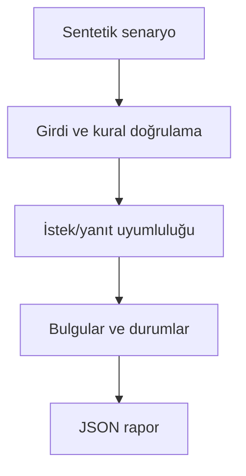

# Mimari

API sürüm değişikliğinin mevcut istemci isteklerini veya yanıt beklentilerini kırmasını önceden görmek.

Asıl alan akışı: **compare(request/response) → change list → BLOCK/REVIEW/PASS**. CLI JSON yükler, çekirdek `run(config)` alan motorunu çağırır ve JSON seri hale getirir. Veritabanı kullanan örnekler geçici dizinde izole edilir; kalıcı sınıflar doğrudan çağrılırken dosya yolu dışarıdan verilir.

## İnvariant ve başarısızlık sınırı

JSON Schema alt kümesi desteklenir; bilinmeyen anahtarlar manuel incelemeye yönlendirilir.

Tam OpenAPI çözümleyicisi değildir; $ref, oneOf ve tüm validator semantiği ayrıca gerekir.

Her hata kararı makine tarafından okunabilir çıktı veya açık exception üretir. Geçersiz yapılandırma sessizce düzeltilmez. Olası tekrarların güvenliği ilgili çekirdeğin kabul kurallarına bağlıdır; bütün projelere ortak bir retry uygulanmaz.
